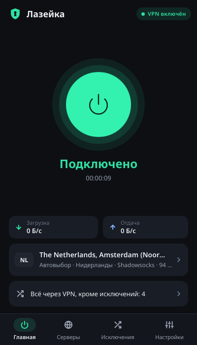
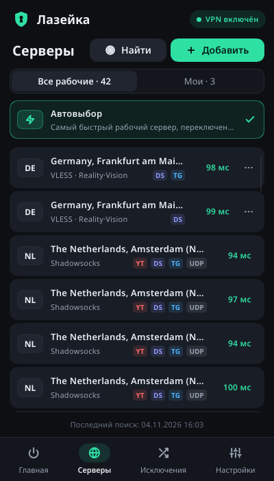
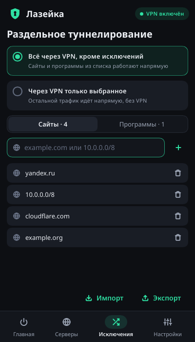
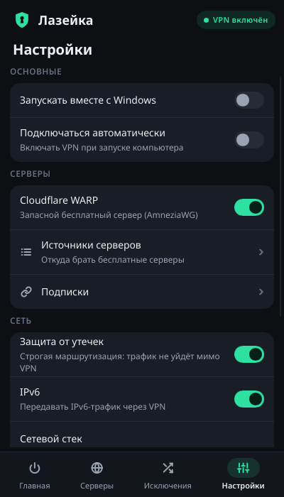

# Лазейка

Лёгкий портативный VPN-клиент для Windows на Rust: автоматически находит, проверяет и подключает бесплатные VPN-серверы, поддерживает пользовательские серверы и подписки, гибкую маршрутизацию (по сайтам, подсетям и процессам), двухзвенные цепочки (`VPN → VPN`, `VPN → WARP`) и встроенный Cloudflare WARP (AmneziaWG / MASQUE). Без телеметрии, регистрации и платных API.

<p>




</p>

## Возможности

- **Протоколы:** VLESS (Reality, XTLS-Vision; TCP/WS/HTTPUpgrade/gRPC/H2/XHTTP), VMess, Trojan, Shadowsocks (включая 2022), Hysteria2, TUIC, AnyTLS, MASQUE (`masque://`), WireGuard, AmneziaWG, OpenVPN (`.ovpn`).
- **Импорт:** ссылки, подписки (base64 / текстовый список / Clash YAML / JSON), WireGuard и AmneziaWG `.conf`, OpenVPN `.ovpn`, контейнеры Amnezia `vpn://` (с защитой от бомб декомпрессии).
- **Многоступенчатый сканер бесплатных серверов:** загружает легальные публичные списки, проверяет TCP/TLS/QUIC, реальный выходной IP (с несколькими независимыми резервными сервисами проверки IP), страну выхода, задержку, отсутствие подмены трафика, работу YouTube/Discord/Telegram, UDP (STUN) и устойчивость к обрывам ТСПУ после ~16 КБ (контрольное скачивание 160 КБ).
- **Двухзвенный обход (`Через входное звено`):** серверы, блокируемые провайдером напрямую (закрытый порт, таймаут, сброс соединения ТСПУ или обрыв после 16 КБ), автоматически проверяются через рабочий входной узел (`dialer-proxy`) с предварительным прогревом туннеля.
- **Строгий выбор страны:** если пользователь выбрал конкретную страну (или страны), автовыбор подключается только к серверам этой страны и никогда скрытно не подменяет её другой страной.
- **Изоляция сбойных узлов (Circuit Breaker):** мёртвые серверы в пуле и маршрутных группах (`R-__default-s`, `R-<id>-s`) автоматически изолируются и вытесняются, исключая бесконечные циклы проверок `context deadline exceeded`. Ошибки авторизации (`AuthRequired`) не помечают сервер мёртвым.
- **Защита HTTP на порту 80:** нешифрованный трафик TCP/80 никогда не отправляется через непроверенные публичные серверы. По умолчанию он идёт через ваш собственный сервер / WARP либо блокируется (`REJECT`), чтобы исключить как перехват трафика чужим узлом, так и утечку реального IP провайдеру. При желании в настройках можно явно разрешить прямой выход порта 80.
- **Анализатор и приоритеты маршрутов:** нумерация правил по приоритету (`№ 1`, `№ 2`), проверка любого домена, `host:port`, IP или `.exe` с показом сработавшего правила, полной цепочки прохождения (`Компьютер → Входной узел → Выходной узел → Интернет`) и перекрытых правил.
- **Cloudflare WARP:** автоматическая регистрация (с локальным шифрованием ключей через Windows DPAPI / ключ привязки и защитой при экспорте паролем), параметры AmneziaWG и автоматическая проверка через входное звено (`VPN → WARP`), когда прямой доступ к Cloudflare заблокирован провайдером.
- **Портативность и безопасность службы Windows:** программа работает из своей папки; перед установкой службы (`LocalSystem`) проверяется файловая система (требуется NTFS с поддержкой ACL) и в обязательном порядке применяется защита прав доступа к папке (`protect_home`), исключающая подмену бинарных файлов непривилегированным процессом. Обновления `mihomo` и программы проверяются по SHA-256 и заголовку PE (`MZ` / `x86_64`).

## Как устроено

Один исполняемый файл `lazeyka.exe` в нескольких ролях:

| Запуск | Роль |
| --- | --- |
| `lazeyka.exe` | окно (Slint) + значок в трее |
| `lazeyka.exe --tray` | запуск сразу в трее (автозапуск) |
| `lazeyka.exe --replace` | окно, заменяющее уже запущенное (после обновления) |
| `lazeyka.exe --service` | служба Windows (`LocalSystem`): движок + ядро `mihomo` |
| `lazeyka.exe --install` / `--uninstall [--quiet]` | установка/удаление службы (с правами администратора и обязательной защитой ACL папки) |
| `lazeyka.exe --engine` | движок в консоли — для разработки и отладки |

Интерфейс и служба общаются через именованный канал `\\.\pipe\Lazeyka` (JSON-строки с ограничением очереди запросов, таймаутами и защитой от флуда мутирующими командами). Туннель поднимает [mihomo](https://github.com/MetaCubeX/mihomo) (TUN через встроенный Wintun).

```
core/        lazeyka-core: модель, реестр бесплатных провайдеров и защита секретов (providers.rs),
             импорт и ссылки, сканер и пробы, диагностика сети (nettest.rs), маршруты и анализатор,
             WARP, конфигурация mihomo, IPC, обновления с проверкой SHA-256/PE, движок
src/         lazeyka: роли exe, интерфейс (ui.rs), служба и установка (win.rs),
             системные функции (sys.rs), headless-режим для тестов
ui/          интерфейс на Slint
assets/      значки (SVG-исходники, .ico, RGBA для трея)
dist/        тексты для дистрибутива
tools/       сборка THIRD-PARTY.txt и zip-архива
```

## Сборка

Нужны Rust (stable, edition 2024) и [llvm-mingw](https://github.com/mstorsjo/llvm-mingw) (UCRT) — на Linux или Windows.

```sh
rustup target add x86_64-pc-windows-gnullvm
export CARGO_TARGET_X86_64_PC_WINDOWS_GNULLVM_LINKER=x86_64-w64-mingw32-clang
export CC_x86_64_pc_windows_gnullvm=x86_64-w64-mingw32-clang
cargo build --release --target x86_64-pc-windows-gnullvm
```

Архив для пользователей:

```sh
tools/package-windows.sh путь/к/mihomo-windows-amd64-compatible.exe \
    путь/к/dbip-country-lite.mmdb out/lazeyka-0.8.0-windows-x64.zip
```

Используйте сборку mihomo **compatible** (`GOAMD64=v1`): обычная `amd64` требует AVX2 и не запустится на части процессоров.

## Разработка и тесты

```sh
cargo test -p lazeyka-core          # модульные тесты ядра, парсеров, маршрутов, безопасности и сканера
cargo test -p lazeyka               # тесты интерфейса и форматирования
```

Движок работает и на Linux: с `LAZEYKA_NO_TUN=порт` вместо TUN поднимается локальный SOCKS/HTTP-прокси.

## Приватность

Нет телеметрии, аналитики и скрытых подключений к серверам разработчика. Секреты, токены и ключи автоматически маскируются в журнале (`[СКРЫТО]`) и защищаются при хранении на диске.

## Лицензия

GPL-3.0-or-later, см. [LICENSE](LICENSE).
